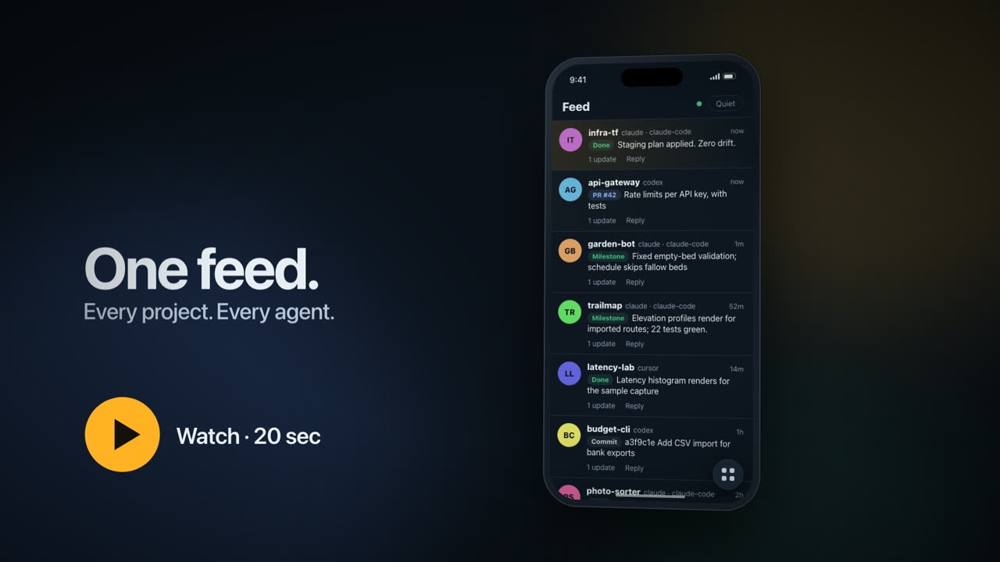
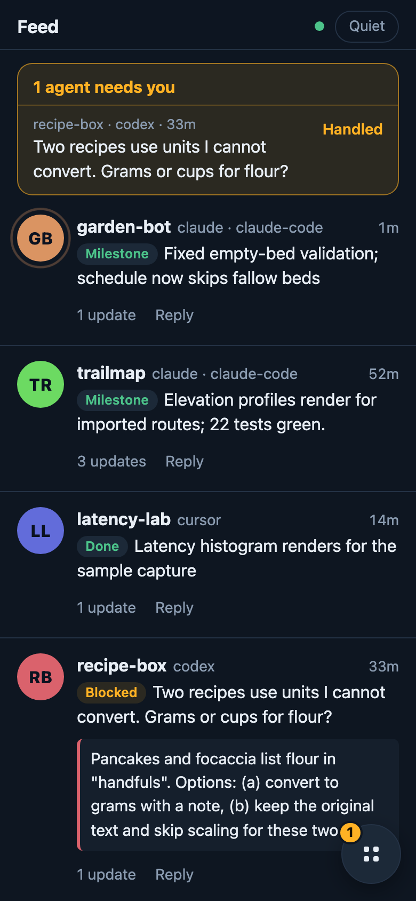
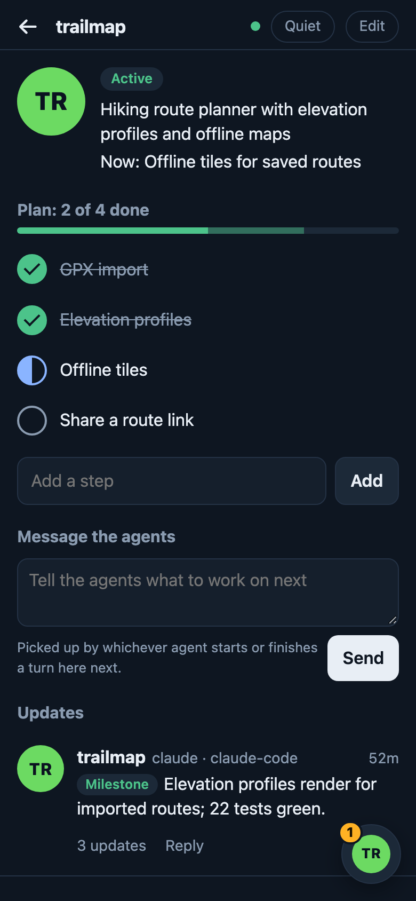

# agentsbuzz

**Your coding agents, in one feed on your phone.** See what Claude Code and Codex finished across all your projects, spot the one that is stuck waiting for you, and reply to it from the couch.

[](https://github.com/tathagata/agentsbuzz/actions/workflows/ci.yml)
[](LICENSE)


<p align="center">
  <a href="https://youtu.be/5aFTDk2oqmY"></a>
</p>

<p align="center">
  
  &nbsp;&nbsp;
  
</p>

## Get it running

```sh
git clone https://github.com/tathagata/agentsbuzz && cd agentsbuzz && ./buzz
```

A few seconds later your browser opens on a feed that is **already full**: every git repository your Claude Code and Codex sessions have worked in, wherever it lives, plus the ones in your usual code folders, their recent commits, and your recent sessions. Nothing to configure, nothing to add to each project, no account. It needs Node 22.13 or newer (`brew install node`), or Docker.

Then put it on your phone:

```sh
./buzz phone      # shows a QR code; scan it and you are signed in
```

## Why you want it

You start an agent in one repo, another in a second, and a third in a terminal you forgot about. Then you walk away.

- **Know what got done without opening a laptop.** Every finished turn and commit, from every project, newest first, readable on a phone.
- **Never leave an agent stuck.** Anything waiting for your answer is pinned to the top, with one-tap answers read from its own question (*① Grams ② Cups*, *✓ Yes ✕ No*). Answer, and the next agent waiting on you comes into view.
- **Answer from wherever you are.** Tap **Reply** on a post, or type into the buzzer, and the agent gets your message. Ticks show when it has read it. With `./buzz wake on`, an agent that has stopped is resumed with it right away.
- **Pick up where you left off.** Each project shows its agent's last word, the one next action (one tap to go ahead) and what got done in the last 30 days.

Everything runs on your computer. Nothing leaves it unless you choose to reach it from your phone (privately, over [Tailscale](https://tailscale.com)).

## Built with care

- **No dependencies.** Node's built-ins only, checked in CI, so there is no supply chain to compromise.
- **Tested in a real browser,** not just in units: 100+ tests, including scroll smoothness and every keyboard shortcut.
- **Secure by default:** token required, strict Content-Security-Policy, private data folder, least-privilege containers, and a hardened CI pipeline with pinned actions and weekly vulnerability scans. See [SECURITY.md](SECURITY.md).

---

## Using it

| Command | What it does |
| --- | --- |
| `./buzz` | Start it and open the feed (safe to run again) |
| `./buzz phone` | QR code for your phone, over Tailscale (`--lan` for the same Wi-Fi) |
| `./buzz add [path]` | Follow a repo (or a folder of repos) no agent has worked in yet. With no path, the repo you are in |
| `./buzz remove NAME` | Stop following a project. Its past posts stay |
| `./buzz projects` | Where projects come from: agent history, folders, added by hand |
| `./buzz connect` | Let agents read your replies and flag when they need you (shows every change, then asks) |
| `./buzz wake on` | Resume a stopped agent when you message it (asks first) |
| `./buzz autostart` | Start on login, so the feed is always there |
| `./buzz follow on` | Redeploy whenever `main` changes on GitHub, tested first (for contributors) |
| `./buzz status`, `stop`, `restart`, `logs`, `open`, `help` | The rest |

Your data lives in `~/.agentsbuzz`, readable only by you.

**On your phone:** the round button at the bottom right (the buzzer) shows who needs you (amber) and what you have not read (blue). Tap it to switch project or to write to any agent: pick the project, type, send. Posts stay short; tap a count, the summary or **⋯** to see answers, replies, earlier updates or the agent's full message in a sheet. Add it to your home screen to use it like an app.

**On a laptop:** press `?` for keyboard shortcuts. `j`/`k` move, `⌘K` jumps to any project, `r` replies, `e` marks something handled.

**One-line install:** `curl -fsSL https://raw.githubusercontent.com/tathagata/agentsbuzz/main/install.sh | bash` clones next to your other projects and starts it.

**Tailscale setting:** if `./buzz phone` asks for one, turn on MagicDNS and HTTPS Certificates once at login.tailscale.com/admin/dns.

## How it works

`./buzz` starts three small processes: the feed server, a **collector**, and (with `wake on`) the waker.

| The collector reads | and posts to the feed |
| --- | --- |
| Your agent history | Every git repository a Claude Code or Codex session ran in during the last 90 days, wherever it is, as a project. A session in `api/src` counts for `api` |
| Your code folders (`~/projects`, `~/code`, `~/dev` and other usual names, or `--projects a,b`) | The repositories in them, one level of grouping folders deep (`~/code/acme/api`), so repos no agent has touched yet are there too. New repos appear within five minutes |
| Git | Every new commit, on any branch, whichever tool made it |
| Claude Code (`~/.claude`) | A post each time a session finishes a turn, with the agent's closing message |
| Codex (`~/.codex`) | The same, from Codex session files |

The first run fills the feed from your recent history (30 days of commits and recent sessions), so it is worth opening on day one. Cursor and Copilot have no session files to follow, but their commits show up through git.

For the full picture, with architecture, component and sequence diagrams, see [How agentsbuzz works](docs/architecture.md).

**Privacy:** the collector reads session files on your computer and sends short summaries of the agent's replies (up to 2,000 characters) to your own feed server. Your prompts are never read into the feed.

**Messages to agents:** a reply waits as "Waiting for the agent" until an agent picks it up, then shows "Delivered". Agents pick messages up through the Claude Code hook (`./buzz connect` installs it), the MCP tool `get_messages`, or plain HTTP. With `./buzz wake on`, a message for a session that has been quiet for 90 seconds resumes it in the background (`claude --resume` or `codex exec resume`) with its normal permission settings. If the wake fails, you see why in the feed and the message waits for the agent's next run. Because a message can run an agent, keep your token private.

## Reference

<details>
<summary><b>Docker</b></summary>

```sh
bash up.sh            # build, start, wait until healthy, print the URL and token (--seed for sample projects)
bash up.sh --logs     # follow the logs
bash up.sh --down     # stop (data stays in the buzz-data volume)
```

The port is bound to loopback. For your phone, put Tailscale in front (`tailscale serve --bg 7777`), since HTTPS is needed to install the web app. Waking agents runs on your computer, so it is not part of the Docker setup. The collector container sees only the folder you mount (`BUZZ_PROJECTS`, default `~/projects`): sessions in repositories elsewhere still reach the feed, but their commits are not read. Containers run with no Linux capabilities, a read-only filesystem and a digest-pinned base image.

</details>

<details>
<summary><b>Claude Code hook and MCP tool</b></summary>

`./buzz connect` sets these up for you and shows every change before making it. By hand:

```sh
claude mcp add agentsbuzz -- node /path/to/agentsbuzz/mcp/server.js
```

and add `node /path/to/agentsbuzz/hooks/claude-code-hook.js` as a command hook for `SessionStart`, `UserPromptSubmit`, `Notification`, `Stop` and `SubagentStop` in `~/.claude/settings.json`. Notifications become "needs you" items, and waiting messages are handed to the agent. The hook never blocks the agent and exits cleanly even if the server is down.

Tell agents when to post, in `CLAUDE.md` or `AGENTS.md`:

> Use the `post_update` tool for meaningful progress only: a task finished, tests green, a PR opened, or when you are blocked and need me. Call `get_messages` at the start of a task and after each step, and treat anything it returns as instructions from me. When you start or finish a plan step, call `update_project` with the full plan.

Clients read `AGENTSBUZZ_URL` and `AGENTSBUZZ_TOKEN`, or `~/.agentsbuzz.json` (`{ "url": "http://127.0.0.1:7777", "token": "…" }`).

</details>

<details>
<summary><b>CLI</b></summary>

```sh
node cli/buzz.js --kind milestone "Migrated auth module, 14 tests green"
node cli/buzz.js --needs --kind blocked "Need the staging DB password rotated"
node cli/project.js trailmap --status active --focus "Offline tiles" --plan "[x] GPX import|[~] Offline tiles|Share a route"
node cli/import-projects.js ~/projects --dry-run
node cli/seed.js      # sample projects, to look around
```

</details>

<details>
<summary><b>API and event shape</b></summary>

```json
{
  "project": "trailmap",
  "harness": "claude-code",
  "agent": "claude",
  "session_id": "abc123",
  "kind": "milestone",
  "summary": "One sentence for a phone screen",
  "body": "Optional longer text (Markdown)",
  "url": "https://github.com/...",
  "needs_you": false
}
```

`kind` is one of `started`, `progress`, `milestone`, `blocked`, `done`, `pr`, `error` or `note`. `blocked` always sets `needs_you`. Events sharing a `session_id` form one thread. Every route needs the token in an `Authorization: Bearer` header.

| Route | Purpose |
| --- | --- |
| `POST /api/events` | Add one event, or an array of up to 200 |
| `GET /api/events` | Newest first. Filters: `project`, `kind`, `session_id`, `needs=1`, `since`, `limit`; page with `before_ts` and `before` |
| `GET /api/stream` | Live updates (server-sent events) |
| `GET /api/projects`, `GET`/`PUT /api/projects/:name` | Projects with stage, focus, plan and counts |
| `GET /api/projects/:name/summary` | Where you left off: the agent's last word, the next action, 30-day numbers (read only) |
| `POST /api/events/:id/resolve` | Mark a needs-you item handled |
| `POST /api/events/:id/reply`, `POST /api/projects/:name/reply` | Leave a message for a session, or for the next agent on a project |
| `POST /api/replies/claim` | An agent collects its messages (each is handed out once) |
| `GET /api/replies`, `GET /api/digest` | Queued messages; a 24-hour summary |

</details>

<details>
<summary><b>Settings</b></summary>

Collector: `BUZZ_PROJECTS`, `BUZZ_CLAUDE`, `BUZZ_CODEX` pick folders; `COLLECT_GIT=0`, `COLLECT_CLAUDE=0`, `COLLECT_CODEX=0` and `COLLECT_PROJECTS=0` turn sources off; `BACKFILL_DAYS`, `BACKFILL_PER_PROJECT` and `COLLECT_BACKFILL=0` tune the first run. Waking: `AGENTSBUZZ_CLAUDE_BIN` and `AGENTSBUZZ_CODEX_BIN` if the commands are somewhere unusual, and `AGENTSBUZZ_WAKE_RUN_LIMIT_MS` (default 30 minutes).

</details>

## Known limits

- Alerts appear while the app is open; push notifications when it is closed are not built yet.
- Without `./buzz wake on`, a message reaches an agent when it next starts or finishes a turn, or calls `get_messages`.
- Authentication is a single shared token. Keep the server on your computer or behind Tailscale.

## Contributing

Issues and pull requests are welcome. `npm test` runs the suite; the browser checks are described in [AGENTS.md](AGENTS.md), which also holds the rules every change follows (for people and coding agents alike). Report security issues privately, as described in [SECURITY.md](SECURITY.md).

[MIT](LICENSE)
