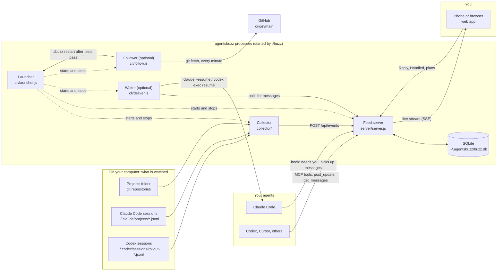
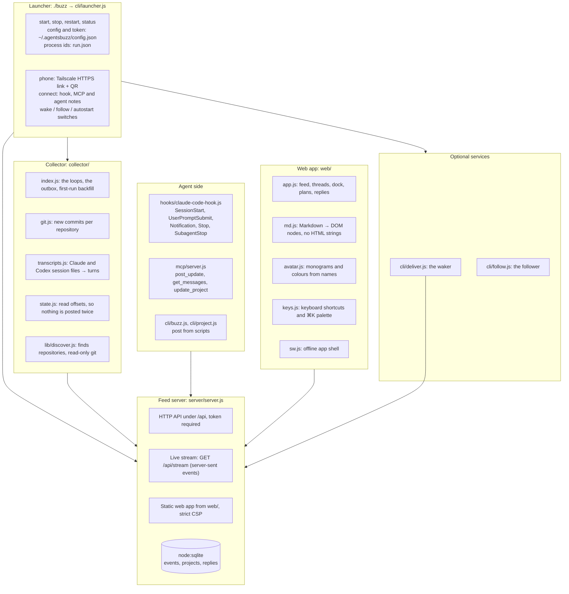
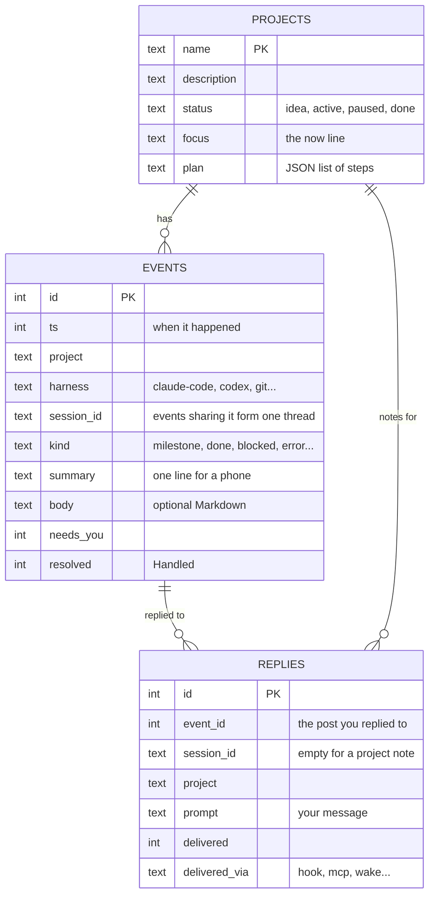
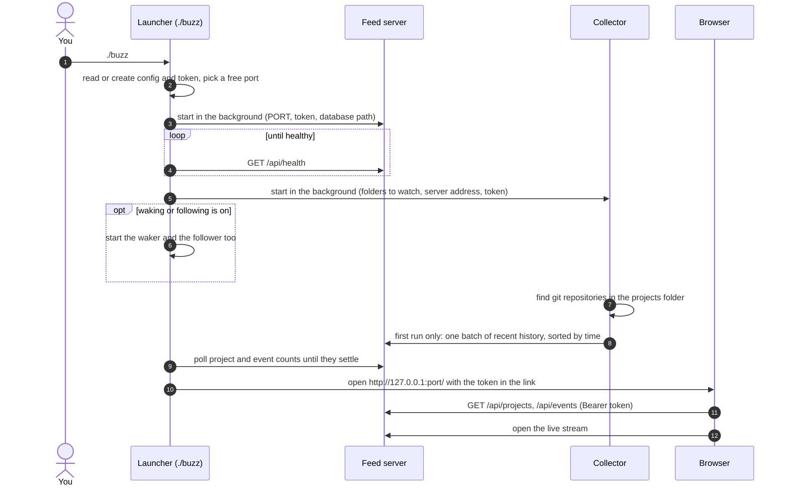
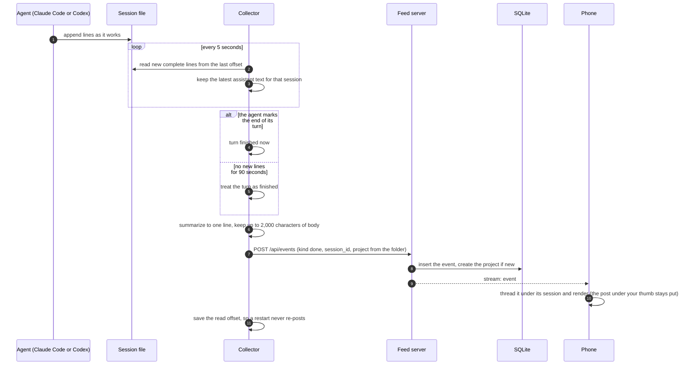
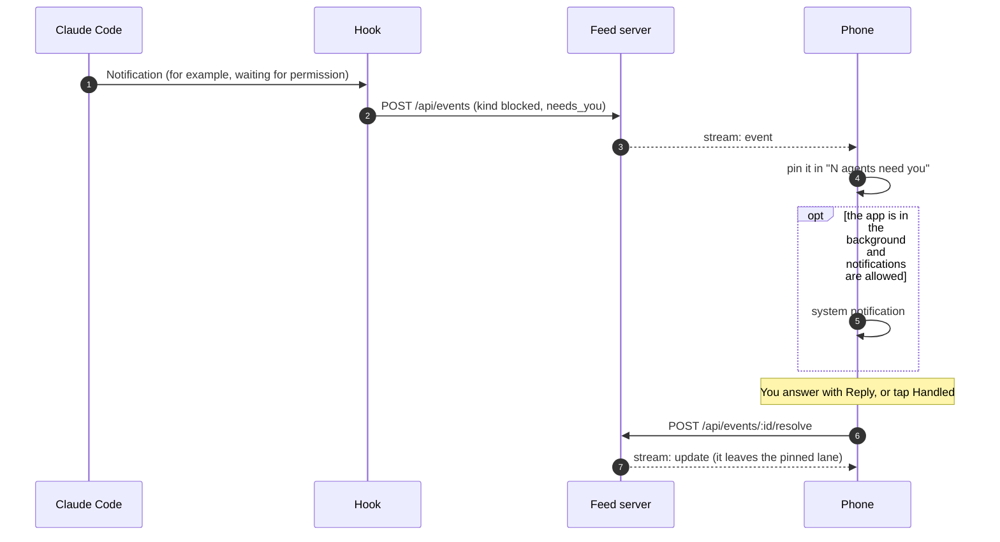
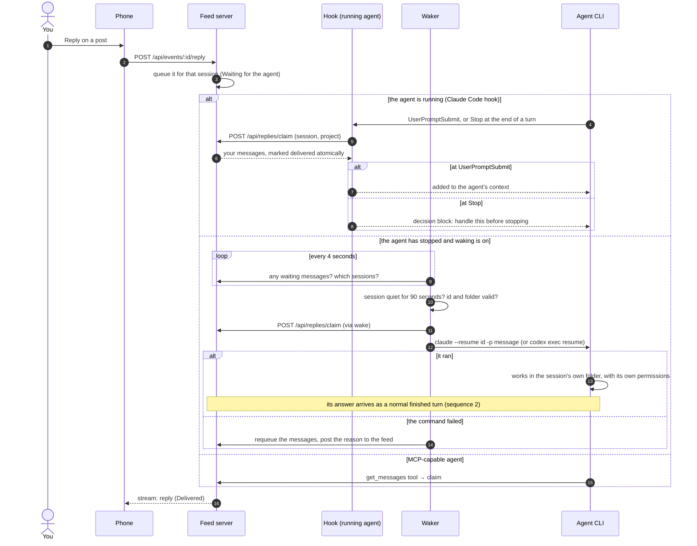
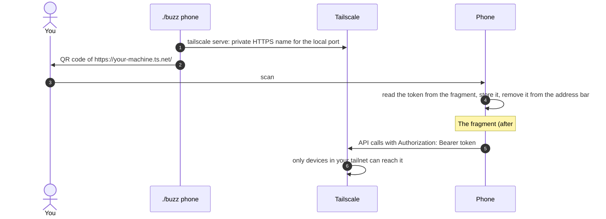
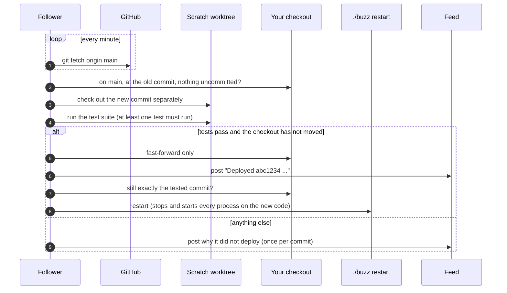

# How agentsbuzz works

agentsbuzz is a few small Node processes on your own computer. They watch what your coding agents and repositories do, keep it in a local SQLite database, and serve it to a web app on your phone, live. When you reply, your message travels back the other way, to the agent.

There are no dependencies beyond Node's built-ins, no cloud service and no account. Everything below runs on the machine where you typed `./buzz`.

- [The big picture](#the-big-picture)
- [Components](#components)
- [Storage](#storage)
- [Sequences](#sequences): [startup](#1-startup), [a finished turn reaches your phone](#2-a-finished-turn-reaches-your-phone), [an agent needs you](#3-an-agent-needs-you), [your reply reaches the agent](#4-your-reply-reaches-the-agent), [phone sign-in](#5-signing-in-on-your-phone), [follow main](#6-follow-main-auto-deploy)
- [The machinery, explained](#the-machinery-explained)

## The big picture

Information flows in two directions:

- **Up (agents → you):** the collector reads files your tools already write (git history and agent session logs) and turns them into feed events. Nothing has to change in your projects.
- **Down (you → agents):** a message you leave is queued in the database until an agent collects it, through the Claude Code hook, the MCP tool, or the waker resuming a stopped session.

## Components

| Component | Runs as | Job |
| --- | --- | --- |
| **Launcher** (`cli/launcher.js`, run by `./buzz`) | A short-lived command | Creates the token and config, picks a port, starts the other processes in the background, records their ids, and handles `phone`, `connect`, `wake`, `follow` and `autostart`. |
| **Feed server** (`server/server.js`) | Background process | The only process that touches the database. Serves the API, the live stream and the web app, and enforces the token and browser security headers. |
| **Collector** (`collector/`) | Background process | Finds your repositories and follows git and agent session files, turning them into events. Remembers how far it has read, so a restart never posts anything twice. |
| **Web app** (`web/`) | Your browser or phone | Renders the feed from the API, applies live updates from the stream, and sends replies, Handled and plan changes. Installable as an app from the home screen. |
| **Claude Code hook** (`hooks/claude-code-hook.js`) | Runs inside Claude Code, on each hook event | Flags "needs you" moments, and hands your waiting messages to the agent. Never blocks the agent; exits cleanly if the server is down. |
| **MCP server** (`mcp/server.js`) | Started by any MCP-capable agent | Lets an agent post milestones, collect your messages and update its project plan. |
| **Waker** (`cli/deliver.js`, with `./buzz wake on`) | Background process | Resumes a stopped agent session when a message for it is waiting. |
| **Follower** (`cli/follow.js`, with `./buzz follow on`) | Background process | Deploys new commits on `main`, after their tests pass. |

## Storage

One SQLite file, `~/.agentsbuzz/buzz.db`, in a folder only you can read (`0700`). The server opens it in WAL mode, so reads never wait for writes.

## Sequences

### 1. Startup

### 2. A finished turn reaches your phone

The collector reads the session files Claude Code and Codex already write, so this needs no setup.

Git works the same way on a slower loop (every 30 seconds): each new commit becomes an event, grouped into one thread per repository per day.

### 3. An agent needs you

Agents without hooks can do the same through the MCP tool `post_update` with `blocked`.

### 4. Your reply reaches the agent

A message is stored first and delivered later, exactly once, by whichever path gets to it first.

If a session has been silent for 30 minutes, its waiting messages may go to the next agent that asks on the same project. A note left on a project, rather than on a post, goes to whichever agent asks first.

### 5. Signing in on your phone

### 6. Follow main (auto-deploy)

## The machinery, explained

**Threads.** Every event carries a `session_id`: an agent's session, or `git:repo:day` for commits. The web app groups events by project and session into one post. The post shows the newest *important* event (milestone, done, PR, blocked, error) as its headline, and the rest as earlier updates behind a tap. That is why a busy session is one post, not fifty.

**Exactly-once delivery.** Claiming messages is a single SQL `UPDATE … RETURNING` that marks rows delivered and returns them in one step. The hook, the MCP tool and the waker can race for the same message and only one wins. If the waker cannot run the agent, it hands its claim back (`/api/replies/requeue`, which can only undo its own claims), so the message is not lost.

**Idle versus active.** The waker treats a session as idle when nothing has been heard from it for 90 seconds. Before that, the agent's own hook will pick the message up at its next turn, and waking it would interrupt. After 30 minutes of silence, a session counts as gone, and its messages may go to the next agent on the project.

**Never posting twice.** The collector stores, for every session file, how far it has read, and for every repository, which commits it has seen (`~/.agentsbuzz/collector-state.json`). It reads only complete lines, skips oversized ones, and survives restarts and rotated files. Events are batched through an outbox and retried if the server is down.

**Live without jank.** The server pushes every change over one server-sent events stream. The app applies changes in place, rebuilds only posts whose content changed, keeps the post under your thumb fixed while new ones arrive above it, and waits for a pause in scrolling before re-rendering. A "↑ N new" pill offers the way back to the top.

**Security boundaries.** Every `/api` route needs the token, compared in constant time and accepted in the address only for the live stream. Browser requests from other websites are refused, and without a token only loopback is served (no DNS rebinding). Every response carries a strict Content-Security-Policy, and the app builds its page with DOM calls, never HTML strings. The waker validates session ids and project folders before anything reaches a command line, and never runs agents for a server without a token. Git is only read, with every hook and helper switched off. [SECURITY.md](../SECURITY.md) has the full list.

**What is optional.** Only the server and collector are needed for a read-only feed. The hook and MCP tool add "needs you" and message delivery to running agents, the waker adds delivery to stopped ones, and the follower adds auto-deploy. Each is switched on with one command that says what it will do first.
